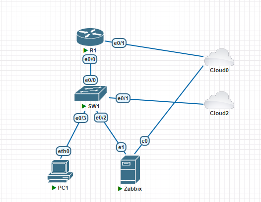
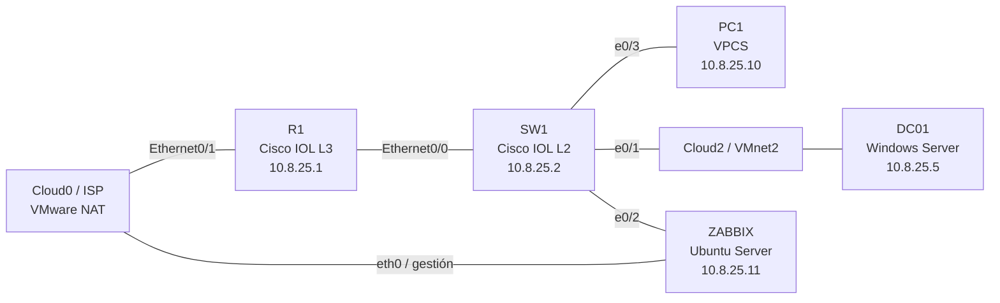
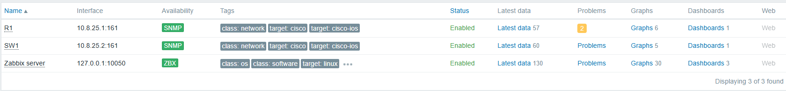
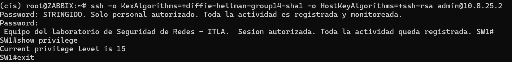
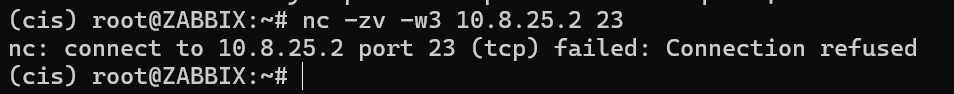
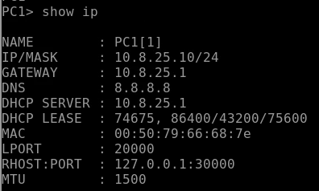
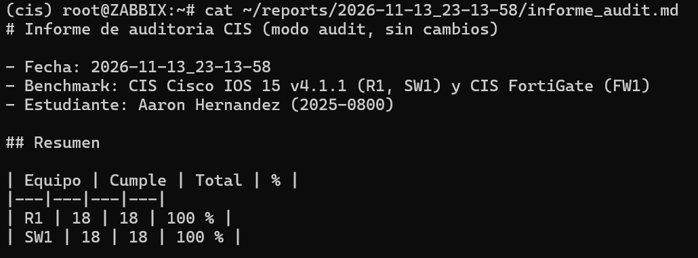
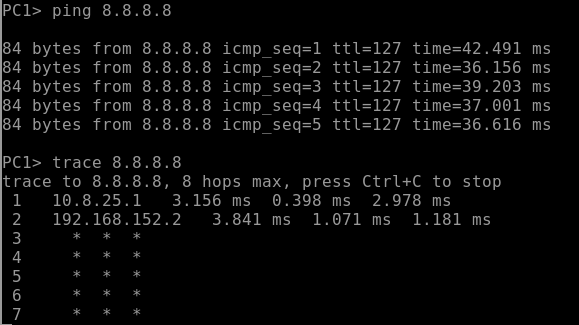

# Infraestructura de red con autenticación RADIUS y hardening CIS

**Estudiante:** Aaron Hernandez  
**Matrícula:** 2025-0800  
**Institución:** Instituto Tecnológico de las Américas (ITLA)  
**Asignatura:** Seguridad de Redes  

---

## Video demostrativo

https://youtu.be/RnrYfJ2ACdw

Duración máxima: 10 minutos. El video muestra la fecha y hora, el rostro y la voz del estudiante, y las pruebas de funcionamiento de los requisitos solicitados.

---

## 1. Propósito del laboratorio

El propósito de esta práctica es implementar una infraestructura de red utilizando equipos Cisco y servidores para proporcionar conectividad, administración segura, autenticación centralizada, monitoreo y protección de los dispositivos.

Se configuró un router Cisco, un switch Cisco IOSvL2, un equipo de usuarios, un servidor Windows Server con Active Directory y NPS, y un servidor Ubuntu con Zabbix.

También se aplicaron y verificaron recomendaciones del CIS Benchmark para mejorar la seguridad del router y del switch.

Los principales servicios implementados fueron:

- Direccionamiento IP y conectividad entre los equipos.
- SNMP de solo lectura y monitoreo mediante Zabbix.
- Autenticación y autorización RADIUS mediante Windows NPS.
- Acceso administrativo mediante SSH.
- DHCP en el router Cisco.
- Hardening basado en CIS Benchmark.
- NAT y ruta por defecto para la salida hacia el ISP.

---

## 2. Topología de red

La infraestructura está compuesta por los siguientes equipos:



### Diagrama lógico



### Conexiones

| Equipo | Interfaz | Conexión |
|---|---|---|
| R1 | Ethernet0/0 | SW1 Ethernet0/0 |
| R1 | Ethernet0/1 | Cloud0 |
| SW1 | Ethernet0/1 | Cloud2 |
| SW1 | Ethernet0/2 | ZABBIX eth1 |
| SW1 | Ethernet0/3 | PC1 eth0 |
| ZABBIX | eth0 | Cloud0 |
| Cloud2 | VMnet2 | DC01 |

### Direccionamiento IP

La red LAN utiliza el direccionamiento `10.8.25.0/24`, basado en la matrícula 2025-0800. El segundo octeto utiliza el 8 de la matrícula y el tercer octeto comienza en 25 por el año 2025.

| Equipo | Interfaz | Dirección IP | Asignación |
|---|---|---|---|
| R1 | Ethernet0/0 | 10.8.25.1 | Estática |
| R1 | Ethernet0/1 | 192.168.152.130 | DHCP |
| SW1 | VLAN 1 | 10.8.25.2 | Estática |
| DC01 | Ethernet | 10.8.25.5 | Estática |
| PC1 | eth0 | 10.8.25.10 | DHCP |
| ZABBIX | eth1 | 10.8.25.11 | DHCP |
| ZABBIX | eth0 | Red Cloud0 | DHCP |

La puerta de enlace de la LAN es `10.8.25.1`. La puerta de enlace del segmento externo utilizado por Cloud0 es `192.168.152.2`.

---

## 3. Direccionamiento y conectividad

Se configuraron los nombres de los equipos y las direcciones IP correspondientes a la infraestructura.

R1 funciona como puerta de enlace de la LAN y permite la comunicación entre los dispositivos conectados al switch.

El servidor DC01 utiliza la dirección estática `10.8.25.5`, mientras que PC1 y ZABBIX reciben sus direcciones mediante DHCP.

Se realizaron pruebas de conectividad mediante ping entre los equipos de la red.


---

## 4. SNMP y monitoreo mediante Zabbix

Se configuró SNMP versión 2c de solo lectura en R1 y SW1 para permitir que el servidor Zabbix consulte información de ambos dispositivos.

Se agregó cada equipo en Zabbix utilizando la plantilla Cisco IOS by SNMP, su dirección IP y la comunidad de solo lectura correspondiente.

En la interfaz web de Zabbix se comprueba el estado de los dos equipos y la recepción de información mediante Latest data.



---

## 5. Autenticación RADIUS mediante Windows Server

Se configuró Windows Server DC01 con Active Directory y Network Policy Server (NPS), utilizando el dominio `lab.local`.

Se creó el grupo `Nivel10` y el usuario `aaronad`, que se utiliza para demostrar la autenticación centralizada.

SW1 fue registrado como cliente RADIUS utilizando la dirección `10.8.25.2` y se configuró para consultar al servidor NPS en `10.8.25.5`.

La política de red permite autenticar a los usuarios pertenecientes al grupo `LAB\Nivel10` mediante PAP y utiliza el atributo Cisco-AV-Pair:

```text
shell:priv-lvl=15
```

Se configuró el siguiente método de autenticación y autorización en SW1:

- Autenticación de inicio de sesión mediante el grupo RADIUS.
- Usuario local como método de respaldo.
- Autorización EXEC mediante RADIUS con respaldo local.

Se realizaron dos pruebas:

1. Inicio de sesión con el usuario `aaronad` de Active Directory, obteniendo privilegio 15.
2. Inicio de sesión con el usuario local `admin` después de detener temporalmente el servicio NPS, comprobando que el respaldo funciona correctamente.



---

## 6. Acceso administrativo mediante SSH

Se configuró SSH versión 2 en el router y el switch para permitir la administración remota segura.

Los equipos utilizan un usuario local con contraseña almacenada mediante el mecanismo `secret` de Cisco.

También se configuraron las líneas VTY para aceptar únicamente conexiones SSH y se aplicó una ACL que restringe el acceso administrativo a la estación ZABBIX, cuya dirección LAN es `10.8.25.11`.

Se comprobó que Telnet no está disponible y que el acceso remoto se realiza mediante SSH.



---

## 7. Servicio DHCP

Se configuró el servicio DHCP en R1 para proporcionar automáticamente direcciones IP a los dispositivos de la LAN.

El servidor DHCP entrega los siguientes parámetros:

- Dirección IP correspondiente a la red `10.8.25.0/24`.
- Puerta de enlace `10.8.25.1`.
- Servidor DNS `8.8.8.8`.

PC1 obtuvo automáticamente la dirección `10.8.25.10`.

Se verificó la asignación mediante `show ip dhcp binding` en R1 y `show ip` en PC1.



---

## 8. Hardening y recomendaciones CIS Benchmark

Se realizó una auditoría de seguridad sobre R1 y SW1 utilizando el CIS Cisco IOS 15 Benchmark v4.1.1.

Para comprobar el cumplimiento de las recomendaciones se utilizó el script `cis_hardening.py`, que dispone de un modo de auditoría sin modificaciones y genera informes con los resultados encontrados.

La auditoría final mostró los siguientes resultados:

| Equipo | Controles cumplidos | Total | Resultado |
|---|---:|---:|---:|
| R1 | 18 | 18 | 100 % |
| SW1 | 18 | 18 | 100 % |

### Controles verificados y motivos de aplicación

| ID CIS | Recomendación | Motivo |
|---|---|---|
| 1.2.2 | Permitir únicamente SSH en las líneas VTY | Evita el uso de Telnet, que transmite las credenciales sin cifrado. |
| 1.2.4 | Crear una ACL para las líneas VTY | Restringe quién puede intentar administrar los equipos. |
| 1.2.5 | Aplicar access-class a las líneas VTY | Hace efectiva la restricción de acceso mediante la ACL. |
| ID por confirmar | Configurar exec-timeout de máximo 10 minutos | Cierra las sesiones que quedan abandonadas. |
| 1.3.1 | Configurar banner exec | Informa sobre el uso autorizado del equipo. |
| 1.3.2 | Configurar banner login | Advierte sobre las restricciones antes de iniciar sesión. |
| 1.3.3 | Configurar banner motd | Muestra un aviso de seguridad al acceder al equipo. |
| 1.4.1 | Utilizar enable secret | Protege la contraseña del modo privilegiado mediante un hash. |
| 1.4.2 | Activar service password-encryption | Evita que las contraseñas aparezcan directamente legibles en la configuración. |
| 1.5.2 | Eliminar la comunidad SNMP private | Evita mantener una comunidad predeterminada conocida. |
| 1.5.3 | Eliminar la comunidad SNMP public | Evita mantener una comunidad predeterminada conocida. |
| 1.5.4 | No utilizar comunidades SNMP RW | Impide modificaciones mediante una comunidad SNMP de escritura. |
| 2.1.1.1.4 | Configurar el tiempo de autenticación SSH | Limita el tiempo disponible para completar la autenticación. |
| 2.1.2 | Deshabilitar CDP | Evita revelar información del dispositivo a los vecinos de red. |
| 2.1.3 | Deshabilitar el servidor BOOTP | Elimina un servicio que no se necesita en la infraestructura. |
| 2.1.8 | Deshabilitar Service PAD | Elimina un servicio heredado que no se utiliza. |
| 2.2.4 | Configurar un servidor de logs remoto | Permite enviar los registros a ZABBIX para su centralización. |
| ID por confirmar | Deshabilitar el servidor HTTP | Reduce la superficie de ataque y evita administrar el equipo mediante HTTP sin cifrado. |

Los dos controles indicados como ID por confirmar se mantienen sin asignar un número que no haya sido verificado en el benchmark.

La configuración del hardening también incluye restricciones administrativas, banners de seguridad, protección de contraseñas y deshabilitación de servicios innecesarios.



### Informe de auditoría

El informe generado durante la auditoría final se encuentra en:

`reports/informe_audit.md`

Este documento contiene el resultado de cada control, su evidencia y la justificación correspondiente.

---

## 9. NAT y ruta por defecto

Se configuró NAT Overload en R1 para permitir que los equipos de la LAN utilicen la interfaz externa del router para salir hacia el ISP.

La interfaz Ethernet0/0 se configuró como NAT inside y Ethernet0/1 como NAT outside.

También se configuró una ruta por defecto mediante la puerta de enlace externa `192.168.152.2`.

Se realizaron pruebas desde PC1:

```text
ping 8.8.8.8
trace 8.8.8.8
```

El ping recibió respuestas correctamente. El traceroute mostró como primeros saltos a R1 (`10.8.25.1`) y al gateway externo (`192.168.152.2`). Los saltos posteriores no respondieron a las sondas, aunque la conectividad con el destino mediante ping fue exitosa.

En R1 se verificaron las traducciones mediante:

```cisco
show ip route
show ip nat translations
show ip nat statistics
```

Las traducciones mostraron tráfico originado desde la LAN hacia el exterior utilizando la dirección de la interfaz WAN.



---

## 10. Estructura del repositorio

El repositorio contiene la documentación, las configuraciones de los equipos de red, los scripts utilizados, el informe de auditoría y las evidencias del laboratorio.

```text
.
├── README.md
│
├── configs/
│   ├── R1.txt
│   └── SW1.txt
│
├── img/
│   ├── 01-topologia.png
│   ├── 03-snmp-zabbix.png
│   ├── 04-radius.png
│   ├── 05-ssh.png
│   ├── 06-dhcp.png
│   ├── 07-cis.png
│   └── 09-nat.png
│
├── reports/
│   └── informe_audit.md
│
└── scripts/
    ├── cis_hardening.py
    └── zbx.sh
```

Las configuraciones de R1 y SW1 se incluyen individualmente. Los valores sensibles de autenticación y las claves compartidas se omiten de las copias públicas.

---
